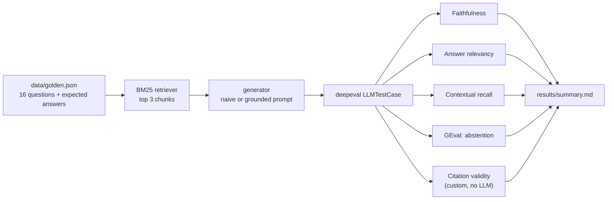

# rag-faithfulness-deepeval

Evaluating a small RAG app with [deepeval](https://github.com/confident-ai/deepeval): does it answer from the
retrieved documents, cite them correctly, and admit when the answer just isn't there?

The knowledge base is a made-up employee handbook for "Lumen Labs" (10 short docs: PTO, expenses, security,
parental leave, ...). Retrieval is a plain BM25 written from scratch, so the eval isn't hiding behind a vector
DB. Two answer prompts are compared over the same retriever:

- **naive**: "use the context to answer the question"
- **grounded**: answer only from context, cite every sentence like `[pto]`, and say exactly
  "The handbook doesn't cover this." when it doesn't

## How it works



The judge is `gpt-oss-120b` on Groq, plugged into deepeval through a small `DeepEvalBaseLLM` wrapper
(`ragkit/judge.py`), so no OpenAI key is needed.

## Golden set

| type | count | example |
|---|---|---|
| single | 9 | "When do I need a doctor's note for sick leave?" |
| multi_hop | 3 | "A 350 EUR course: do I need approval, and does it come out of my home office stipend?" (needs two docs) |
| unanswerable | 4 | "What is the company's 401k match percentage?" |

Unanswerable questions are the interesting part. A model that answers them confidently is hallucinating, even
if it sounds helpful. They're scored on faithfulness, abstention and citations only (relevancy/recall don't
make sense when the right answer is "not in the docs").

## Metrics

| metric | from | what it catches |
|---|---|---|
| Faithfulness | deepeval | claims in the answer that aren't supported by the retrieved chunks |
| Answer relevancy | deepeval | rambling or answering a different question |
| Contextual recall | deepeval | the retriever missing a chunk needed for the expected answer |
| Abstention | deepeval `GEval`, custom rubric | answering an unanswerable question, or refusing an answerable one |
| Citation validity | custom `BaseMetric` | citing a doc that wasn't retrieved, or no citation at all |

## Setup

Python 3.10+ and a free [Groq API key](https://console.groq.com/keys).

```bash
python -m venv .venv
.venv\Scripts\activate        # Windows
source .venv/bin/activate     # macOS / Linux
pip install -r requirements.txt
```

Set `GROQ_API_KEY` as an env var or in `.env` (see `.env.example`).

## Run

```bash
python run_eval.py                                          # both prompts, gpt-oss-20b
python run_eval.py --model groq:qwen/qwen3.8-27b --variants grounded
python run_eval.py --only q09 q13                           # a couple of questions
python report.py                                            # rebuild summary.md
pytest -q                                                   # offline tests (retriever, citation metric)
```

## Results

Full run in progress on the Groq free tier (it's rate limited, so it takes a while). The tables will be added
here and in `results/summary.md` once it finishes. You can reproduce everything with the commands above.

## Credits

Built with [deepeval](https://github.com/confident-ai/deepeval) (Apache 2.0). The handbook, the questions, the
retriever and the custom metrics are written for this project.

## License

MIT
