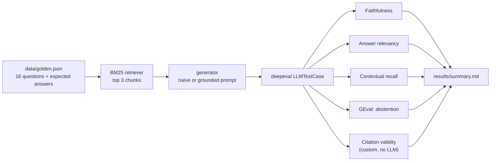

# rag-faithfulness-deepeval

Evaluating a small RAG app with [deepeval](https://github.com/confident-ai/deepeval): does it answer from the
retrieved documents, cite them correctly, and admit when the answer just isn't there?

The knowledge base is a made-up employee handbook for "Lumen Labs" (10 short docs: PTO, expenses, security,
parental leave, ...). Retrieval is a plain BM25 written from scratch, so the eval isn't hiding behind a vector
DB. Two answer prompts are compared over the same retriever:

- **naive**: "use the context to answer the question"
- **grounded**: answer only from context, cite every sentence like `[pto]`, and say exactly
  "The handbook doesn't cover this." when it doesn't

## How it works



The judge is `gpt-oss-120b` on Groq, plugged into deepeval through a small `DeepEvalBaseLLM` wrapper
(`ragkit/judge.py`), so no OpenAI key is needed.

## Golden set

| type | count | example |
|---|---|---|
| single | 9 | "When do I need a doctor's note for sick leave?" |
| multi_hop | 3 | "A 350 EUR course: do I need approval, and does it come out of my home office stipend?" (needs two docs) |
| unanswerable | 4 | "What is the company's 401k match percentage?" |

Unanswerable questions are the interesting part. A model that answers them confidently is hallucinating, even
if it sounds helpful. They're scored on faithfulness, abstention and citations only (relevancy/recall don't
make sense when the right answer is "not in the docs").

## Metrics

| metric | from | what it catches |
|---|---|---|
| Faithfulness | deepeval | claims in the answer that aren't supported by the retrieved chunks |
| Answer relevancy | deepeval | rambling or answering a different question |
| Contextual recall | deepeval | the retriever missing a chunk needed for the expected answer |
| Abstention | deepeval `GEval`, custom rubric | answering an unanswerable question, or refusing an answerable one |
| Citation validity | custom `BaseMetric` | citing a doc that wasn't retrieved, or no citation at all |

## Setup

Python 3.10+ and a free [Groq API key](https://console.groq.com/keys).

```bash
python -m venv .venv
.venv\Scripts\activate        # Windows
source .venv/bin/activate     # macOS / Linux
pip install -r requirements.txt
```

Set `GROQ_API_KEY` as an env var or in `.env` (see `.env.example`).

## Run

```bash
python run_eval.py                                          # both prompts, gpt-oss-20b
python run_eval.py --model groq:qwen/qwen3.8-27b --variants grounded
python run_eval.py --only q09 q13                           # a couple of questions
python report.py                                            # rebuild summary.md
pytest -q                                                   # offline tests (retriever, citation metric)
```

## Results

Run on 2026-10-21 via Groq: generator `gpt-oss-20b`, judge `gpt-oss-120b`, same 16 questions and retriever for both prompts. Per-question scores, answers and judge reasons are in [`results/summary.md`](results/summary.md).

Average score per metric, pass count in brackets. Unanswerable questions are only scored on faithfulness, abstention and citations. Citations are only scored for the grounded prompt (the naive prompt doesn't ask for them).

| run | faithfulness | answer_relevancy | contextual_recall | abstention | citations | cases fully passed |
|---|---|---|---|---|---|---|
| `grounded__openai_gpt-oss-20b` | 0.96 (14/16) | 0.92 (10/12) | 0.92 (10/12) | 0.91 (14/16) | 1.00 (16/16) | **12/16** |
| `naive__openai_gpt-oss-20b` | 1.00 (16/16) | 0.97 (11/12) | 0.96 (11/12) | 0.91 (15/16) | - | **13/16** |

### By question type

| run | type | passed |
|---|---|---|
| `grounded__openai_gpt-oss-20b` | single | 6/9 |
| `grounded__openai_gpt-oss-20b` | multi_hop | 2/3 |
| `grounded__openai_gpt-oss-20b` | unanswerable | 4/4 |
| `naive__openai_gpt-oss-20b` | single | 8/9 |
| `naive__openai_gpt-oss-20b` | multi_hop | 2/3 |
| `naive__openai_gpt-oss-20b` | unanswerable | 3/4 |

**What stands out**

- **Grounding fixed hallucination on unanswerable questions (3/4 → 4/4).** Asked how many PTO days contractors get, the naive prompt reasoned "the policy only covers employees, so contractors get none" and stated it as policy. The grounded prompt said "The handbook doesn't cover this." Every citation it produced pointed at a chunk that was actually retrieved (16/16).
- **But it cost accuracy on answerable questions (8/9 → 6/9 single-fact).** On the course-budget question it wrote that the home office stipend is "only for monitors, keyboards, and mice". The handbook never says "only", and faithfulness caught it. On the premium-economy question it added a half-right aside about the learning budget.
- **Not every failure is the model's.** On "when do salary changes take effect?" the answer was correct ("1 April [performance]") but answer relevancy scored it 0.5, treating the citation tag as irrelevant content. On the probation question the answer was correct but left out the post-probation notice period, and the abstention rubric marked it down. Both are grader artifacts worth knowing about before trusting the totals.
- Net: the grounded prompt is the safer one for a policy bot (it stops making things up), and the remaining errors are about over-confident paraphrasing, which a stricter "quote, don't summarise" rule would likely target.

## Credits

Built with [deepeval](https://github.com/confident-ai/deepeval) (Apache 2.0). The handbook, the questions, the
retriever and the custom metrics are written for this project.

## License

MIT
